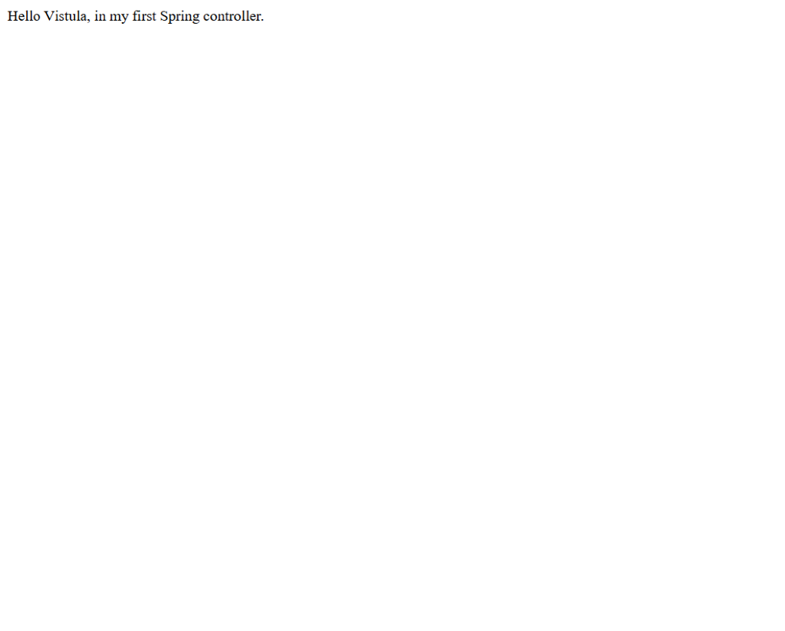
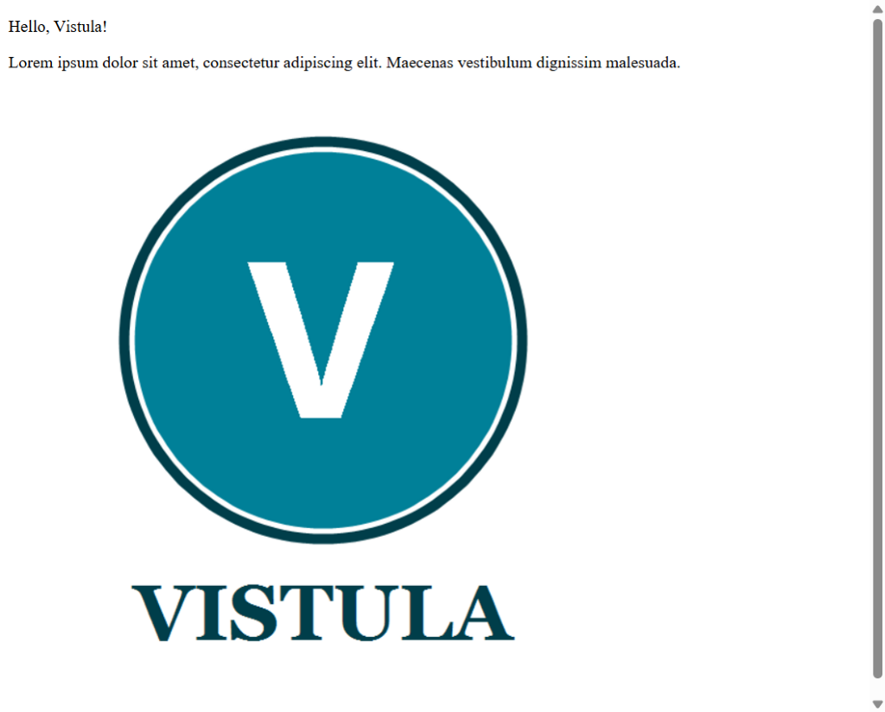
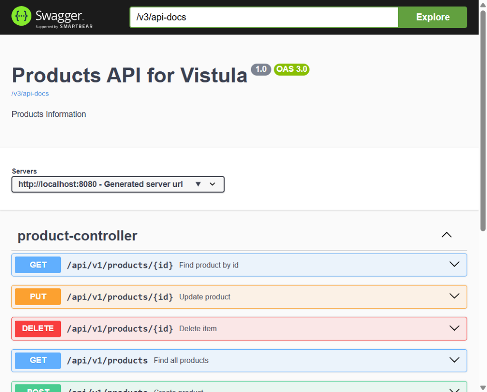
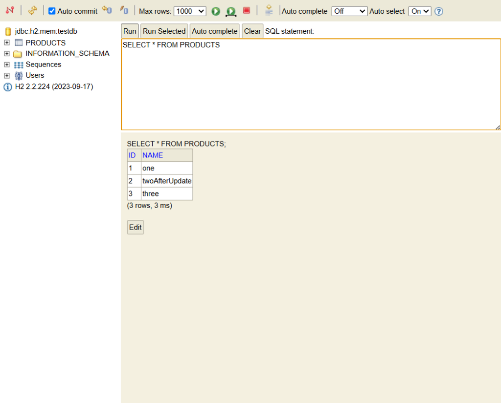

# Exercise 16 — First Two Spring Framework Apps

Two Spring Boot applications built with Java 17 and Maven for **Akademia Finansów i Biznesu Vistula** (Java Programming — Exercise 16).

## Tech Stack

- **Java 17** & **Spring Boot 3.3.5**
- **Maven**
- **Task 1:** Spring Web, Thymeleaf, Lombok
- **Task 2:** Spring Web, Spring Data JPA (Hibernate), H2 In-Memory Database, Spring Boot DevTools, Springdoc OpenAPI / Swagger UI

---

## Project Structure

```text
.
├── first-project-java-spring/   # Task 1: First Spring Boot MVC & Thymeleaf App
├── First-Rest-Api-Spring/       # Task 2: Products REST API + Swagger + Exception Handling + H2 JPA
└── docs/images/                 # Application screenshots
```

---

## Task 1 — `first-project-java-spring` (Spring MVC & Thymeleaf)

A basic Spring Boot web application demonstrating `@Controller`, `@ResponseBody`, `@GetMapping`, `@RequestParam`, and server-side rendering with Thymeleaf.

### Endpoints

| Method | Endpoint | Description |
| --- | --- | --- |
| `GET` | `/` | Returns plain text `"Hello Vistula, in my first Spring controller."` using `@ResponseBody` |
| `GET` | `/greeting?name=Vistula` | Renders `templates/greeting.html` with the passed `name` parameter and `static/images/vistula.png` |

### Why `@ResponseBody` is used on `hello()`
When a controller class is annotated with `@Controller`, Spring treats returned `String` values as template/view names (e.g., `"greeting"` resolves to `greeting.html`). Adding `@ResponseBody` to `hello()` tells Spring to write the returned string directly to the HTTP response body instead of looking for a view template.

### Screenshots

#### `GET http://localhost:8080/`


#### `GET http://localhost:8080/greeting?name=Vistula`


---

## Task 2 — `First-Rest-Api-Spring` (REST API, Swagger UI, H2 & JPA)

A layered RESTful backend for managing `Product` resources with full CRUD operations, OpenAPI/Swagger documentation, custom exception handling (`@ControllerAdvice`), and persistence via Spring Data JPA + H2 in-memory database.

### Layered Architecture

- `product.api` — `ProductController`, `request` (`ProductRequest`, `UpdateProductRequest`), `response` (`ProductResponse`)
- `product.domain` — `Product` JPA entity (`@Entity(name = "products")`)
- `product.service` — `ProductService` (business logic)
- `product.repository` — `ProductRepository` (`extends JpaRepository<Product, Long>`) and `OldProductRepository` (previous in-memory `HashMap` implementation)
- `product.support` — `ProductMapper`, `ProductExceptionSupplier`, `ProductExceptionAdvisor`, `exception.ProductNotFoundException`
- `shared.api.response` — `ErrorMessageResponse`

### REST API Endpoints (`/api/v1/products`)

| Method | Endpoint | Description | Status Code |
| --- | --- | --- | --- |
| `POST` | `/api/v1/products` | Create a new product | `201 Created` |
| `GET` | `/api/v1/products/{id}` | Find a product by ID | `200 OK` / `404 Not Found` |
| `GET` | `/api/v1/products` | List all products | `200 OK` |
| `PUT` | `/api/v1/products/{id}` | Update an existing product | `200 OK` / `404 Not Found` |
| `DELETE` | `/api/v1/products/{id}` | Delete a product by ID | `204 No Content` / `404 Not Found` |

#### Example `404 Not Found` Error Response
```json
{
  "message": "Product with 99 not found"
}
```

### How does `ProductRepository` work without method implementations?
`ProductRepository` extends `JpaRepository<Product, Long>`, which declares CRUD methods (`save`, `findById`, `findAll`, `deleteById`, etc.). At application startup, **Spring Data JPA** automatically generates a dynamic proxy implementation (backed by `SimpleJpaRepository`) and registers it as a Spring bean, which is then injected into `ProductService`.

### Screenshots

#### Swagger UI (`http://localhost:8080/swagger-ui/index.html`)


#### H2 Database Console (`http://localhost:8080/console/` — `jdbc:h2:mem:testdb`)


---

## Running & Testing

### Run Task 1
```bash
cd first-project-java-spring
mvn spring-boot:run
```
- Hello endpoint: `http://localhost:8080/`
- Greeting page: `http://localhost:8080/greeting?name=Vistula`

### Run Task 2
```bash
cd First-Rest-Api-Spring
mvn spring-boot:run
```
- Swagger UI: `http://localhost:8080/swagger-ui/index.html`
- OpenAPI JSON: `http://localhost:8080/v3/api-docs`
- H2 Console: `http://localhost:8080/console/` (JDBC URL: `jdbc:h2:mem:testdb`, User: `sa`, Password: empty)

### Run Tests
```bash
mvn -f first-project-java-spring/pom.xml test
mvn -f First-Rest-Api-Spring/pom.xml test
```
